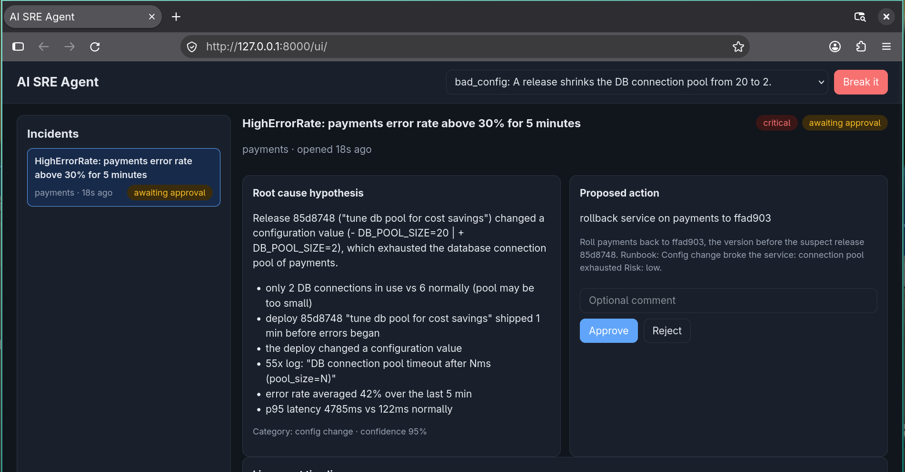
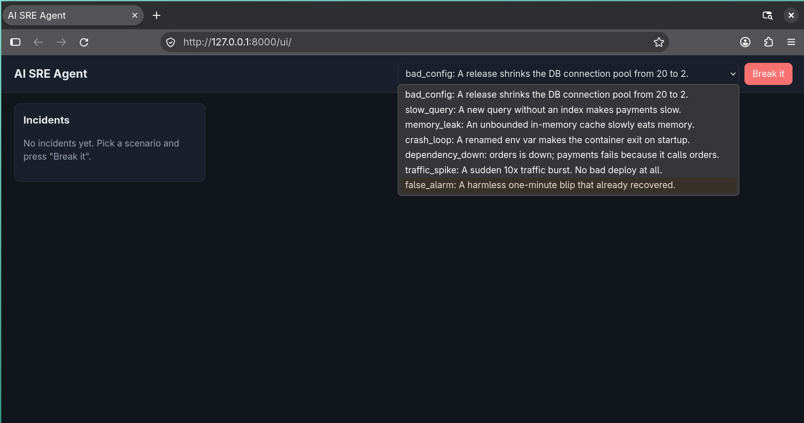
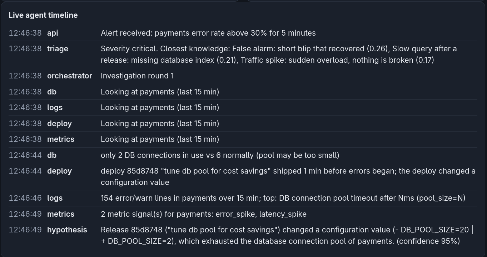
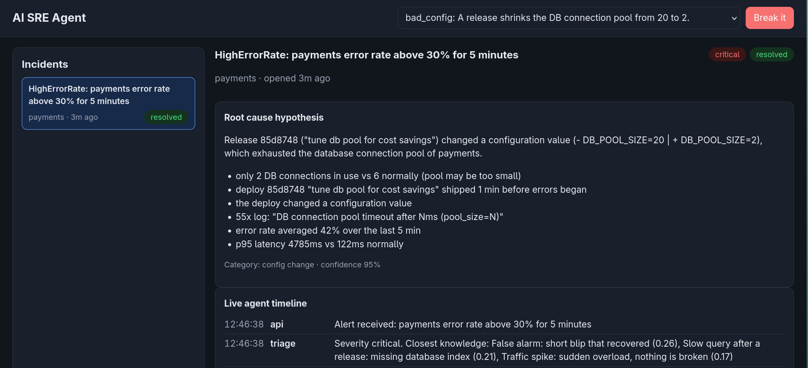
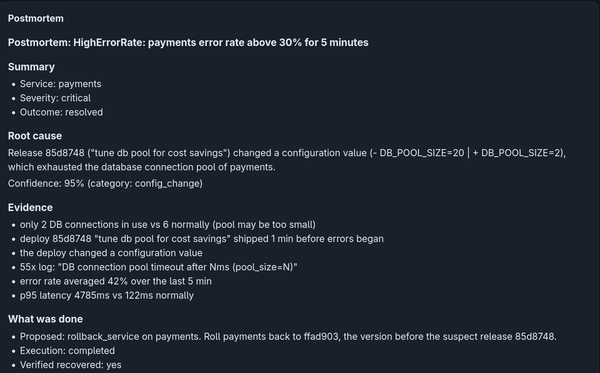
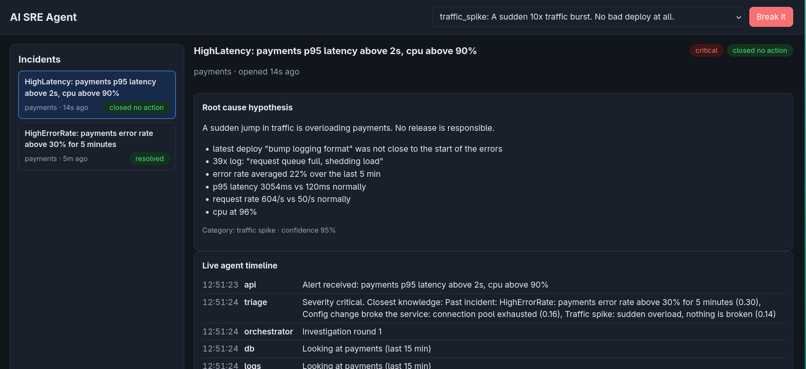

# AI SRE Agent

An incident-response system built with **LangGraph, MCP tool servers, FastAPI, Redis Streams and Postgres/pgvector**. When an alert fires, four investigators (logs, metrics, deploys, database) work in parallel, a critic challenges the theory, a human approves the fix, and a postmortem is written and remembered for the next incident.



## What it does

1. An alert arrives on a signed webhook and is de-duplicated, so the same problem never creates two incidents.
2. A worker starts a LangGraph workflow. Triage searches past incidents and runbooks (RAG with pgvector).
3. Four investigators run in parallel and gather evidence through MCP tool servers (logs, metrics, github, postgres).
4. A hypothesis is formed and a critic tries to disprove it. If it is weak, the investigation widens and repeats, then escalates to a human.
5. The system proposes a fix and **pauses**. Its state is saved in Postgres until a human approves or rejects.
6. After approval, a fifth MCP server (docker) runs the action, guarded by an approval token. The system verifies recovery, writes a postmortem and stores it for next time.

## Screenshots

| Choose a failure to simulate | Live agent timeline |
|---|---|
|  |  |

| Resolved incident | Postmortem |
|---|---|
|  |  |

**It knows when not to act.** A traffic spike is not a bad release, so the system proposes no change:



## Architecture

```
Alert -> FastAPI webhook -> Redis Stream -> Worker -> LangGraph
   triage (RAG over runbooks and past incidents)
   -> 4 investigators in parallel (logs, metrics, deploys, database) via MCP servers
   -> hypothesis <-> critic loop
   -> propose fix -> HUMAN APPROVAL (graph pauses, state saved in Postgres)
   -> execute (docker MCP server, needs an approval token) -> verify
   -> postmortem -> stored and embedded (pgvector)
Dashboard: live timeline over server-sent events, approve / reject buttons.
```

## Tech stack

Python 3.12, FastAPI, LangGraph (with the Postgres checkpointer), MCP (Model Context Protocol) servers, SQLAlchemy (async), Postgres with pgvector, Redis Streams, Docker Compose, pytest. The dashboard is plain HTML, CSS and JavaScript with no build step.

## Status and honesty notes

- **Rule-based by default.** The investigators and the critic run on plain Python rules, so the project works offline and gives repeatable results. Set `ANTHROPIC_API_KEY` to let an LLM also write the hypothesis, review it as the critic, and write the postmortem.
- **Simulated environment.** The "services" are generated logs, metrics and deploys stored in Postgres. The rollback tool writes healthy data instead of redeploying a real container. Swapping in a real action means changing only `mcp_servers/docker_server.py`.

## Requirements

- Docker Desktop (with Docker Compose)
- Python 3.12, only if you want to run the tests or the evaluation outside Docker

## Run it

1. Create your environment file and start everything:
   ```bash
   cp .env.example .env
   docker compose up --build
   ```
   The first build takes a few minutes. Wait until you see `worker ready` in the logs.
2. Open http://localhost:8000
3. Pick a scenario, press **Break it**, and watch the timeline fill up. When the status becomes "awaiting approval", read the proposal and press **Approve**. The system runs the action, verifies recovery and writes the postmortem.
4. Try all seven scenarios. Two of them (`traffic_spike`, `false_alarm`) correctly end with "no action needed". In `dependency_down` the right answer is to restart `orders`, not `payments`.

Ports used: 8000 (app), 5434 (Postgres), 6380 (Redis). Change them in `docker-compose.yml` if they clash.

To start from a clean slate (deletes all incidents and saved state): `docker compose down -v`.

## Scenarios

| Scenario | What happens | Correct outcome |
|---|---|---|
| `bad_config` | A release shrinks the DB connection pool from 20 to 2 | Roll back |
| `slow_query` | A new query without an index | Roll back |
| `memory_leak` | An unbounded cache grows | Restart |
| `crash_loop` | A renamed environment variable | Roll back |
| `dependency_down` | `orders` is down, `payments` fails because it calls it | Restart `orders` |
| `traffic_spike` | Ten times the traffic, no bad deploy | No action |
| `false_alarm` | A one-minute blip that already recovered | No action |

## Optional: use a real LLM

Without a key the system uses its built-in rule engine. To let an LLM write the hypothesis, review it as the critic, and write the postmortem, put your key in `.env`:

```
ANTHROPIC_API_KEY=sk-ant-...
```

then run `docker compose up -d --force-recreate api worker`. If a call fails, the system falls back to the rule engine and says so in the timeline. The LLM is always given the rule engine's answer as a hint, and the critic only accepts when both agree. Never commit your `.env` file.

## Run the tests

```bash
python -m venv .venv && source .venv/bin/activate    # Windows: .venv\Scripts\activate
pip install -r requirements.txt
pytest -q
```

The tests need no database. `test_offline_pipeline.py` replays all seven scenarios through the real investigator code with a fake tool layer and checks the diagnosis, the critic's verdict and the proposed action against the answer key.

## Evaluate the whole system

With `docker compose up` running:

```bash
python -m eval.run_eval --runs 3
```

It breaks each scenario, approves the proposal, waits for the end, compares the diagnosis with the answer key, and prints accuracy and timing. Results are saved to `eval/results.json`.

| Metric | Result |
|---|---|
| Correct root-cause category | 21 / 21 |
| Median time to a finished incident | 11 s |
| Actions run without human approval | 0 |

## Send a signed alert by hand

```bash
python -m victim.chaos run bad_config --send
```

Loads the scenario data into Postgres, then posts the alert to the webhook with an HMAC signature, the way a monitoring tool would. Posting the same alert twice while the first is open attaches to the same incident instead of creating a new one.

## How the pieces map to the code

| Piece | Where |
|---|---|
| Webhook, signature check, dedupe | `app/api/webhooks.py`, `app/core/tokens.py`, `app/services/incidents.py` |
| Queue and worker | `app/queue/stream.py`, `app/worker.py` |
| LangGraph workflow | `app/orchestrator/graph.py`, `nodes.py`, `state.py` |
| What each investigator concludes | `app/orchestrator/analysis.py` |
| Rule engine (classify, critic, fix, postmortem template) | `app/orchestrator/heuristics.py` |
| MCP servers (tools) | `mcp_servers/*.py` |
| SQL safety guard | `mcp_servers/sqlguard.py` |
| RAG (embeddings, pgvector search) | `app/rag/`, `runbooks/` |
| Fake world and scenarios | `victim/generate.py` |
| Dashboard | `dashboard/` |
| Evaluation | `eval/run_eval.py` |

## Safety design

- All tools are read-only except the docker server, which is a separate process.
- Docker tools refuse to act without an approval token. The token is an HMAC of incident id + action + target, created only when a human approves that exact action.
- `readonly_query` accepts a single SELECT, blocks writes and the answer-key table, and has a 3 second timeout.
- Only allowlisted services can be restarted or rolled back.
- Logs are shown to the LLM as data, and the prompts tell it never to follow instructions found inside them. The dashboard renders everything with `textContent`.
- Every tool call is stored in `tool_calls`, every decision in `approvals`, every step in `agent_events`.

## Known limits

- The environment is simulated: fixing an incident means the docker server writes healthy data. Swapping in real containers means changing only `mcp_servers/`.
- Tables are created with `create_all` at startup. Add Alembic when the schema starts changing.
- Redis Streams, not Kafka. One worker processes incidents one at a time.
- A rejected proposal escalates to a human instead of looping back to the hypothesis step.
- No login on the dashboard, and the `/dev` endpoints are open, so do not expose it to the internet as it is.
- Two identical alerts in the same millisecond could create two incidents. A unique partial index on open fingerprints would fix it.

## Troubleshooting

- `docker compose logs worker` and `docker compose logs api` show what is going on.
- "address already in use": change the host port in `docker-compose.yml`.
- Incident stuck on "open": the worker is not running or cannot reach Redis.
- Changed the SQL in `db/init`: run `docker compose down -v` so Postgres re-initialises.
- `redis-cli -p 6380 XLEN sre:dead` shows how many messages failed processing.